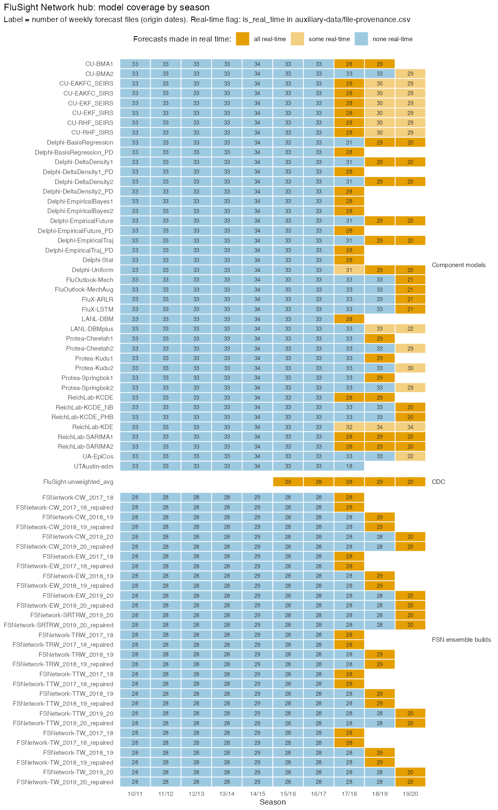

# FluSight Network Hub (archive)

A [hubverse](https://hubverse.io)-format archive of the influenza forecasts collected by the
[FluSight Network](https://github.com/FluSightNetwork/cdc-flusight-ensemble) (FSN) for the 2010/11–2019/20
US influenza seasons: 30+ component models, each with its **real-time** submissions (2017/18–2019/20) and
the **training** (out-of-sample backcast) submissions used to fit ensemble weights, the FSN collaborative
ensembles, and CDC's unweighted average of FluSight submissions.

The FluSight Network and its forecasts are described in two papers:

- Reich NG, Brooks LC, Fox SJ, et al. (2019).
  [A collaborative multiyear, multimodel assessment of seasonal influenza forecasting in the United States](https://doi.org/10.1073/pnas.1812594116).
  *PNAS* 116(8):3146–3154. Compares 22 models' forecasts of seven targets for the 2010/11–2016/17
  seasons against a historical baseline: the component models' backcasts in this archive.
- Reich NG, McGowan CJ, Yamana TK, et al. (2019).
  [Accuracy of real-time multi-model ensemble forecasts for seasonal influenza in the U.S.](https://doi.org/10.1371/journal.pcbi.1007486)
  *PLOS Computational Biology* 15(11):e1007486. Describes FSN's stacked ensembles of 21 component models
  and their real-time performance in 2017/18, when the ensemble FSN submitted to CDC placed second in
  the FluSight challenge.

FSN's interactive visualization of these forecasts is at [flusightnetwork.io](http://flusightnetwork.io/).

## What was forecasted

Weighted influenza-like illness (wILI) from CDC's ILINet, for the US and the 10 HHS regions
(`location`: `US National`, `HHS Region 1` … `HHS Region 10`). Forecasts are made each week
(`origin_date` = the Saturday ending the most recent week of data, MMWR week *EWxx* in the source file
names). `location`, `origin_date`, `target`, `horizon` and `target_end_date` are the hub's
[task ID variables](https://docs.hubverse.io/en/latest/user-guide/tasks.html#task-id-vars), the columns
that identify what each forecast is for.

| [`target`](https://docs.hubverse.io/en/latest/overview/terminology.html#target) | Meaning | `horizon` / `target_end_date` | [Output types](https://docs.hubverse.io/en/latest/user-guide/model-output.html#formats-of-model-output) |
|---|---|---|---|
| `ili perc` | wILI % for the week ending `target_end_date` | 1–4 weeks ahead | `pmf`, `median` |
| `season peak perc` | highest weekly wILI % of the season | empty | `pmf` |
| `season onset wk` | first week of 3 consecutive weeks at/above the regional baseline | empty | `pmf` |
| `season peak wk` | week of the season's highest wILI | empty | `pmf` |

- **Probability mass function (pmf) bins.** wILI was scored on a one-decimal scale, so `ili perc` /
  `season peak perc` bins are labelled by their left edge `"0.0"` … `"13.0"`; `"13.0"` is the large bin
  [13, 100]. Week targets are labelled by the Saturday ending each MMWR week (`YYYY-MM-DD`), plus `"none"`
  (no onset) for `season onset wk`. Each season is its own
  [modeling round](https://docs.hubverse.io/en/latest/overview/terminology.html#round) in
  [`hub-config/tasks.json`](https://docs.hubverse.io/en/latest/user-guide/hub-config.html#tasks-metadata).
- **Medians are computed.** FluSight "point" forecasts were inconsistently defined. The submissions have
  a mix of median bin, mean, or other, and several models' point forecasts contradict their own pmf. The
  `median` here is the left edge of the first bin whose cumulative probability reaches 0.5; 13.0 where it
  falls in the open bin. Only for weekly `ili perc`, as in the current CDC FluSight hub. The original
  points are kept unchanged in `auxiliary-data/`.

## Model IDs and real-time forecasts

Each [model output](https://docs.hubverse.io/en/latest/user-guide/model-output.html) file belongs to a
`model_id`, described by a [model metadata](https://docs.hubverse.io/en/latest/user-guide/model-metadata.html)
file in `model-metadata/`.

| Model ID | Contents |
|---|---|
| `<team>-<model>` | every round of a component model: real-time forecasts where they exist, FSN's training backcasts otherwise |
| `<team>-<model>1`, `…2` | for component models retrained between seasons, add one ID per version (`CU-BMA`, `Protea-Cheetah/Kudu/Springbok`) |
| `FluSight-unweighted_avg` | CDC's unweighted average of FluSight submissions, 2015/16–2019/20 (real-time) |
| `FSNetwork-<ABBR>_<YYYY_YY>` | one FSN ensemble build: the leave-one-season-out forecasts FSN made before season YYYY/YY to choose its ensemble, plus that season's real-time forecasts (for the ensemble sent to CDC, the file actually submitted). `<ABBR>` stands for the ensemble variation used. |
| `FSNetwork-<ABBR>_<YYYY_YY>_repaired` | the same build with FSN's last-week stacking bug repaired (see below) |

FSN rebuilt its ensembles before each season it ran in real time (`src/ensemble_builds.csv`):

| Build | Methods (`ABBR`) | Leave-one-season-out seasons | Real-time season | Sent to CDC |
|---|---|---|---|---|
| `_2017_18` (2017-11-04) | CW, EW, TRW, TTW, TW | 2010/11–2016/17 | 2017/18 | TTW |
| `_2018_19` (2018-10-23) | CW, EW, TRW, TTW, TW | 2010/11–2017/18 | 2018/19 | TW |
| `_2019_20` (2019-10-25) | CW, EW, SRTRW, TTW, TW | 2010/11–2018/19 | 2019/20 | TTW |

CW constant weights, EW equal weights, TW target-based, TTW target-type-based, TRW
target-and-region-based, SRTRW static regularized target-region weights. Each build covers weeks
EW43–EW18 of the earlier seasons.



*Weekly forecast files per model ID and season (made by `src/plot_coverage.R`).*

**Which forecasts were made in real time?** Each model's metadata lists its `real_time_seasons`, and
`auxiliary-data/file-provenance.csv` has an exact `is_real_time` flag for every file. For evaluation of
forecasts made in real-time you can filter on `is_real_time`.

- **Real-time** means first committed to the FSN repository (or CDC's, for the unweighted average) no
  more than 3 days after the FluSight due date (the Monday 9 days after `origin_date`); the last version
  committed by then is used.
- **Training backcasts.** Teams re-ran their backcasts several times, and FSN overwrote the files each
  time: the source's git history holds about 15,000 earlier versions of 6,500 of the backcast files used
  here. The hub keeps one version of each file:
  - by default, the version in FSN's `component-models/` folder at commit `58bd222` (2019-10-25), the
    snapshot from which FSN built its last ensemble (2019/20 weights and leave-one-season-out forecasts);
  - for version 1 of a retrained model (`CU-BMA1`, `Protea-*1`), the version just before the retraining
    commit, i.e. the backcasts the 2017/18 and 2018/19 ensembles were built from;
  - for the ReichLab `kcde_backfill` models (`ReichLab-KCDE_NB`, `_PHB`), their 2019-10-26 re-run;
  - for models FSN removed before 2019-10-25 (e.g. Delphi `…_PD`, LANL-DBM, UTAustin-edm,
    ReichLab-KCDE), the last version before removal.

  Other versions are not converted; all are listed in `validation/source-history.csv`. As a result the
  backcasts are not always the files an earlier ensemble build used: the 2017/18 build used earlier
  versions of 490 of them (163 files each of ReichLab-KCDE, -SARIMA1 and -SARIMA2, from before a
  2018-03-16 fix to their onset rounding; 12 of CU-BMA1; 1 of CU-EAKFC_SEIRS). The ensemble forecasts
  themselves are always FSN's own files.
- **One version of each forecast.** Where FSN's training copy of a round is identical to the real-time
  file, it is not repeated. Where it differs (2 files), the real-time file is used and the training
  version is kept unchanged in `auxiliary-data/superseded-forecasts.parquet`. A few rounds exist only as
  real-time-folder files committed after the cutoff; they are included with `is_real_time = FALSE`.
- **Versions.** CU-BMA and the three Protea models were retrained before the 2019/20 season. Version 1
  holds the original backcasts plus the 2017/18–2018/19 (CU) or 2018/19 (Protea) real-time forecasts;
  version 2 holds the retrained backcasts plus 2019/20. Metadata `fsn_ensemble_component_seasons`
  records which seasons' FSN ensembles each model (version) was a component of.
- **Ensemble builds overlap.** The same season appears in several builds (e.g. 2015/16 is a
  leave-one-season-out season in all three; 2017/18 is real-time in `_2017_18` and leave-one-season-out
  in `_2018_19` and `_2019_20`). Pick one build per analysis; the builds differ in components and
  weights.

## Changes made to the source data

Every change is logged; everything else is bit-identical to the source (verified for all 128M source bin
values, `validation/roundtrip.csv`).

- **Bin labels** standardised (`1` vs `1.0`, week numbers → dates; CU's week numbers past 52 rolled
  over).
- **Renormalisation**: pmfs whose probabilities summed to within 0.1 of 1 were divided by their sum;
  larger deviations were excluded (`excluded_output/`). Log: `validation/changes.parquet`.
- **Repaired ensemble builds** (`…_repaired`): FSN's stacking code joined bins on start *and* end.
  Components label the last week of the year differently ([52, 1) vs [52, 53); week 53 in 2014/15), so
  some components' probability for that bin was dropped from leave-one-season-out onset/peak-week
  forecasts. The repair recomputes only that bin from FSN's own components and weights; all other
  values, and all real-time files, are identical to FSN's (`validation/cv-repair.csv`). The originals
  are kept under the unrepaired IDs.
- **Stale files not converted.** The 2017/18 and 2018/19 build trees still held EW19/EW20
  leave-one-season-out files from an interim build of 2017-10-24 that FSN never rebuilt; they are listed
  in `validation/file-map-excluded.csv`.

## Target data

The hub's [target data](https://docs.hubverse.io/en/latest/user-guide/target-data.html) are
`target-data/time-series.csv` (weekly wILI;
[time series](https://docs.hubverse.io/en/latest/user-guide/target-data.html#target-time-series)) and
`target-data/oracle-output.parquet`
([oracle output](https://docs.hubverse.io/en/latest/user-guide/target-data.html#target-oracle-output):
1 for the observed bin, 0 otherwise; observed value for medians), keyed like the model output.

- 2010/11–2018/19: FSN's own truths (`scores/target-multivals.csv` in the source repository). Where FSN
  listed several tied peak weeks (14 location-seasons), the week with the highest **unrounded** ILINet
  wILI is used (`src/peak_week_ties.csv`).
- 2019/20 (and 11 late-2018/19 weeks): FSN computed no truths; they are **derived** with FSN's
  definitions from ILINet as of issue 202028 (FSN's week-28 convention) and CDC's 2019/20 baselines.
  The method reproduces all FSN truths for 2010/11–2018/19 exactly. `truth_source` marks each row.
- **ILINet data come from the [Delphi Epidata API](https://cmu-delphi.github.io/delphi-epidata/api/fluview.html)**
  (`fluview` endpoint), as snapshots of specific issues: YYYY28 after each season, and 201352 for HHS
  regions before 2013/14 (FSN's fallback). They are used for the derived truths and to break peak-week
  ties, and are saved in `auxiliary-data/ilinet/issue-YYYYWW.csv` (`src/fetch_ilinet.R`). FSN's own
  truths for 2010/11–2018/19 are used as published, not refetched.
- **2019/20 onset and peak use a season ending EW09-2020** (week ending 2020-02-29) so that
  COVID-19-affected spring weeks are not scored as the peak. Weekly `ili perc` truths are not cut.

## Using the data with hubverse tools

Read the hub with [hubData](https://hubverse-org.github.io/hubData/):

```r
library(hubData)
hub <- connect_hub("path/to/flusight-network-hub", file_format = "parquet")
hub |> dplyr::filter(target == "ili perc", output_type == "pmf",
                     !startsWith(model_id, "FSNetwork-")) |>
  hubData::collect_hub()
prov <- read.csv("path/to/flusight-network-hub/auxiliary-data/file-provenance.csv")
# keep real-time forecasts only: semi-join on model_id + origin_date where prov$is_real_time
```

Known tool limitations (see `src/11_smoke_modelimportance.R`):

- Seasonal targets have empty `horizon` / `target_end_date`; hubEvals/scoringutils drop rows with
  missing task IDs, so remove those all-empty columns before scoring seasonal targets.
- `modelimportance::model_importance()` renames `origin_date` to `reference_date` in the forecasts but
  not in the oracle data; rename the oracle column too.

## Repository layout

See the hubverse [hub structure](https://docs.hubverse.io/en/latest/user-guide/hub-structure.html) and
[hub configuration](https://docs.hubverse.io/en/latest/user-guide/hub-config.html) documentation.

| Path | Contents |
|---|---|
| `hub-config/` | `tasks.json`, `admin.json`, `model-metadata-schema.json` (hubverse schema v6.0.0) |
| `model-output/` | one parquet file per model and round *(added in later PRs)* |
| `model-metadata/` | one YAML file per model ID |
| `target-data/` | time series and oracle output *(PR 2)* |
| `auxiliary-data/` | original point forecasts, file provenance (`is_real_time`), superseded forecasts, ILINet snapshots *(PR 2)* |
| `excluded_output/` | forecasts excluded by the quality rules *(with model output)* |
| `figures/` | the model coverage figure |
| `src/` | the conversion pipeline (see `src/README.md`) |
| `validation/` | manifests, file map, change logs and check results |
| `.github/workflows/` | CI: hub config validation, model-output/metadata validation with [hubValidations](https://hubverse-org.github.io/hubValidations/) on PRs (submission-window check skipped), round-aware target-data validation |

## Source and licence

Source: [FluSightNetwork/cdc-flusight-ensemble](https://github.com/FluSightNetwork/cdc-flusight-ensemble)
(master `8c3100af`, 2020-05-04, plus earlier versions from its full git history), and, for
FluSight-unweighted_avg 2018/19–2019/20, [cdcepi/FluSight-forecasts](https://github.com/cdcepi/FluSight-forecasts)
(master `b1ac3830`, CC BY 4.0). This repository is licensed
[CC BY-NC-SA 4.0](https://creativecommons.org/licenses/by-nc-sa/4.0/), as is the source (see
[`LICENSE`](LICENSE)). Related archive:
[hubverse-org/flusight_hub_archive](https://github.com/hubverse-org/flusight_hub_archive) (CDC FluSight
submissions, 2015/16–2019/20).
